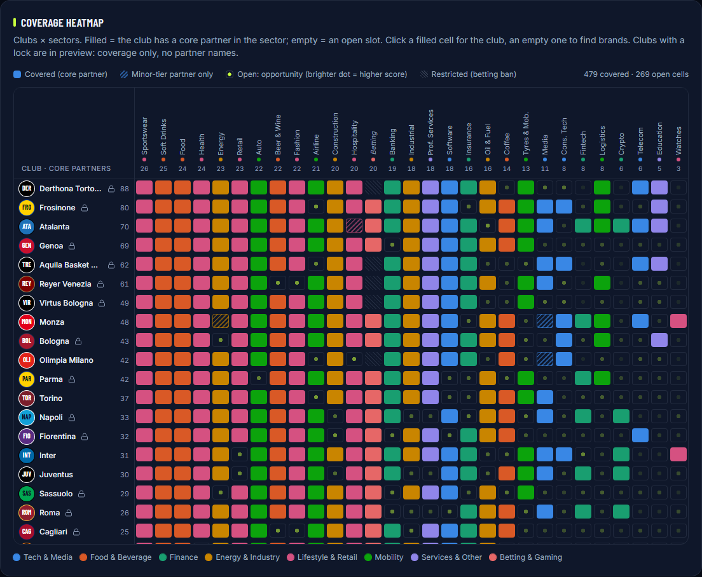
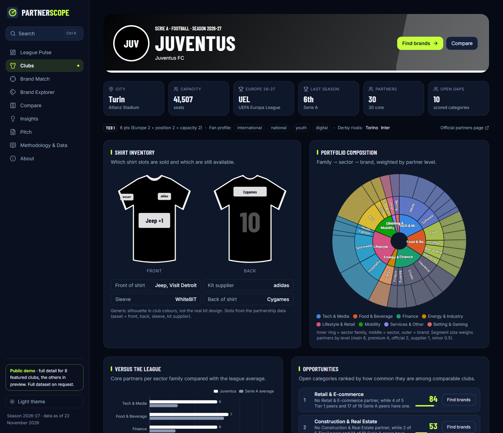
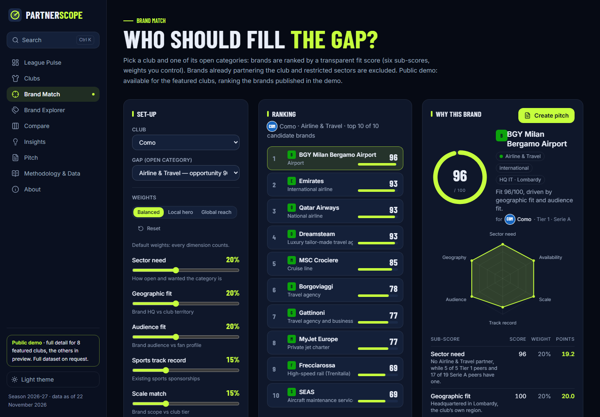
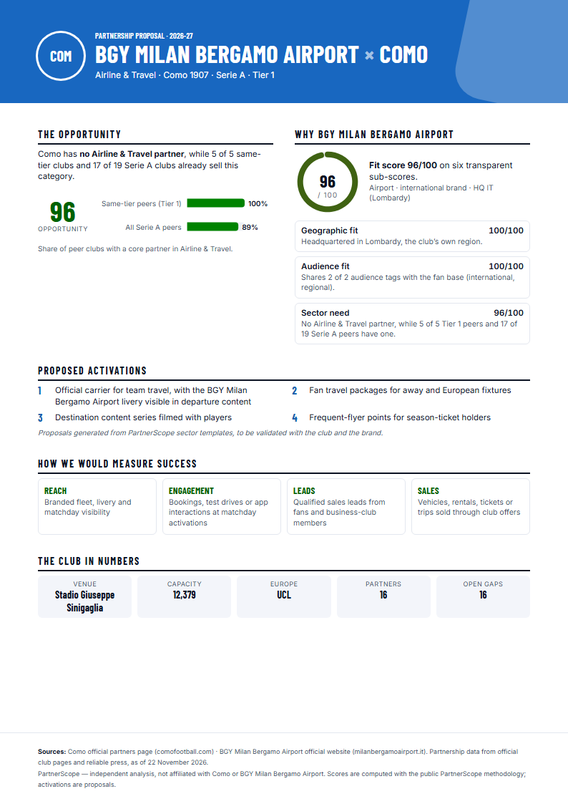

# PartnerScope

**Sponsorship intelligence for Italian football & basketball: who sponsors every Serie A club, which categories are still open and which brands fit.**

  

**Live demo:** https://alecamera10.github.io/partnerscope/ · _Public preview – full dataset and source code available on request._

## What it does

- **Maps every sponsorship.** All 20 Serie A 2026-27 clubs and the 6 LBA basketball clubs playing in European cups, with each partner classified by sector, partnership level and shirt slot.
- **Finds the open categories.** For every club, an opportunity score shows which sectors comparable clubs already sell and that club does not.
- **Matches brands to clubs.** A transparent fit score ranks candidate brands for each open category, then turns the best match into a one-page partnership proposal.

## Key numbers

| Metric                                 | Value                           |
| -------------------------------------- | ------------------------------- |
| Clubs                                  | 26 (20 Serie A + 6 LBA)         |
| Partnerships mapped                    | 1,794 (1,035 core partners)     |
| Brands                                 | 1,651                           |
| Sectors in the taxonomy                | 30, in 8 families               |
| Partnerships citing an official source | 99.8%                           |
| Cross-check accuracy                   | 97.6% (416 records re-verified) |

## Screenshots

**Club profile with shirt inventory** – which shirt slots are sold, the portfolio mix and the open categories.

**Brand Match** – candidate brands for an open category, ranked by fit score, with every sub-score explained.

**Pitch** – a one-page partnership proposal built from the data.

## How the scoring works

- **Opportunity score (0–100).** For a club with no core partner in a sector: 60% the share of same-tier clubs that have one, plus 40% the share of all league clubs. Betting is never proposed (advertising ban in Italy).
- **Brand fit score (0–100).** A weighted mean of six sub-scores: sector need, geographic fit, audience fit, sports track record, scale match, and conflicts (derby rivals, categories already held). Weights are adjustable, with three presets.
- **Club tiers.** Computed from European competition, last season's position and stadium capacity, with rules declared per league.
- Every score is deterministic and comes with a one-line explanation in the app.

## How it was built

- **Data from official sources.** Club partner pages and official releases first, reliable sports-business press second. Every record keeps its source URL and access date; unverifiable data is left empty, never guessed.
- **Cross-checked.** An independent check of every front-of-shirt and kit-supplier deal plus a random sample of the others: 97.6% confirmed as recorded, the rest corrected.
- **Stack.** React + TypeScript, ECharts, Tailwind CSS and Vite; data validated with zod; unit, end-to-end and accessibility tests. It runs entirely in the browser.
- **AI-assisted development with Claude Code.**

## Public preview

This demo shows full detail for 8 featured clubs: Juventus, Milan, Inter, Olimpia Milano, Atalanta, Como, Torino and Monza. The other clubs appear in preview, with only their number of core partners and the sectors they cover. Data export and PDF proposals are part of the full version.

**Public preview – full dataset and source code available on request.**

## Disclaimer

PartnerScope is an independent project. It is not affiliated with, endorsed or sponsored by Lega Serie A, Lega Basket Serie A, any club or any brand mentioned. Names are used only to identify clubs and brands; no logos or crests are used. Data is a snapshot as of 22 November 2026 and sponsorships change during the season.

## Contact

**Alessandro Umberto Camera** · [LinkedIn](https://www.linkedin.com/in/alessandro-umberto-camera)

© 2026 Alessandro Umberto Camera. All rights reserved.
